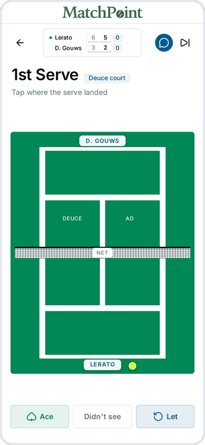
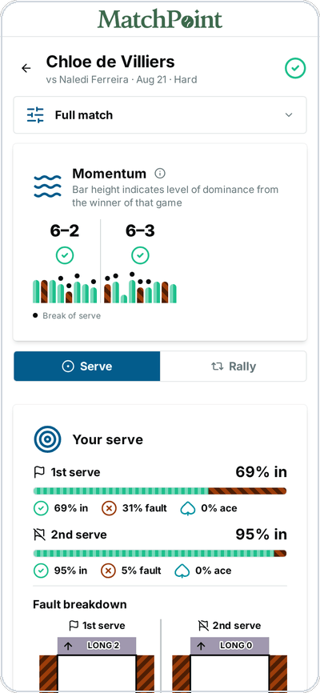
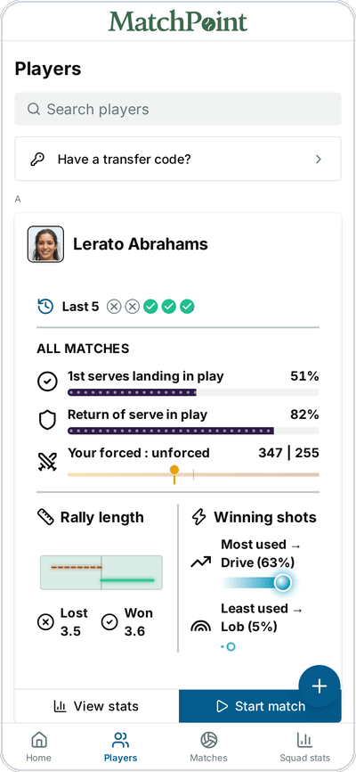
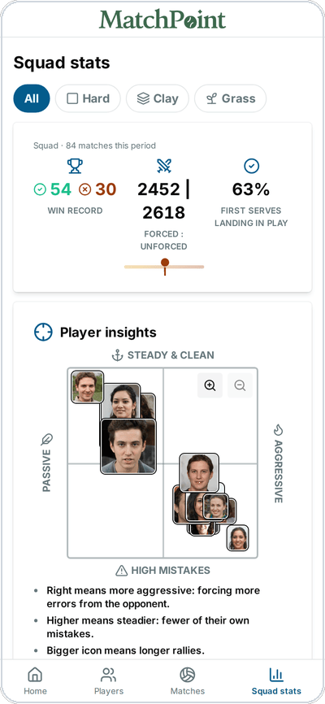
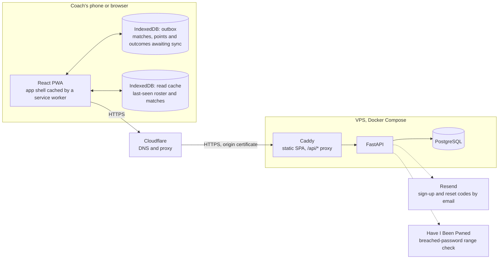

# MatchPoint

Pro-level match stats for amateur tennis coaches, logged courtside on a phone.


[](LICENSE)

Professional players get detailed match statistics from specialist tracking systems and post-match
video analysis. Amateur coaches and players have neither, so spotting patterns and planning training
from evidence is hard. MatchPoint is a progressive web app that lets a coach record every point
courtside on a phone and turns those records into match, player, and squad analytics. Capture is
built around a tap-on-the-court interface: a single tap where the ball landed records whether it was
in, where it fell or how it missed, and who won the point. A scoring engine keeps the score across
seven match formats.

<table>
  <tr>
    <td align="center" width="25%"><br><sub>Tap where the serve landed</sub></td>
    <td align="center" width="25%"><br><sub>Review a match</sub></td>
    <td align="center" width="25%"><br><sub>Track a player</sub></td>
    <td align="center" width="25%"><br><sub>Compare the squad</sub></td>
  </tr>
</table>

Because courts may have poor signal, the app is offline-first. Points are saved to an on-device
outbox and synced later. The outbox is kept apart from the read cache, so clearing cached data can
never lose an unsynced point. Uploads are idempotent, and the server rebuilds each score from the
stored events, so retries and out-of-order delivery always reach the same result.

The analytics dashboard follows Shneiderman's mantra of "overview first, zoom and filter, then
details on demand". Its palette is adapted from Okabe–Ito to be safe for colour-blind readers, and
every colour also carries a pattern, so no chart depends on colour alone. Players can sign in to
view their own statistics, and a one-time transfer code moves a player, with their full match
history, to a new coach.

The design and engineering decisions are written up in [`docs/`](docs/): the tech stack, data model,
offline sync, scoring systems, colour palette, security, infrastructure, CI/CD, testing, and
AI-assisted development.

## Architecture



Solid arrows are the request path, from the app through the proxy to the database; dotted arrows are
the API's calls to third-party services; cylinders are data stores.

Points captured during a match are appended to the outbox on the device, never sent directly. The
sync layer drains the outbox to the API whenever a connection exists, so the capture screen behaves
the same with or without signal. The outbox and the read cache are separate databases, so clearing
cached reads can never touch a point that has not synced. Caddy serves the app and proxies `/api/*`
from one hostname, so there is no cross-origin traffic to configure. The server stores what it
receives and answers the analytics queries; the scoring itself runs on the device. See
[docs/offline-sync.md](docs/offline-sync.md) for the sync protocol and
[docs/security.md](docs/security.md) for the policy behind the two external calls.

## Stack

| Layer    | Key technologies                                                                            |
| -------- | ------------------------------------------------------------------------------------------- |
| Frontend | React · Vite · TypeScript · Tailwind · shadcn/ui · TanStack Router/Query · Dexie · Recharts |
| Backend  | FastAPI · Pydantic · SQLAlchemy · Alembic · Python                                          |
| Infra    | PostgreSQL · Caddy · Docker Compose · GitLab CI                                             |

See [docs/tech-stack.md](docs/tech-stack.md) for the full breakdown with versions, tooling, and test
frameworks.

## Development

These instructions target Ubuntu/Debian Linux, including WSL2. macOS is not supported, because the
scripts under `scripts/` rely on bash associative arrays and GNU `date`. On Windows, run every
command from your WSL2 distro's bash shell, not PowerShell or cmd.

### Prerequisites

| Tool   | Version    | Notes                                                                                                  |
| ------ | ---------- | ------------------------------------------------------------------------------------------------------ |
| Node   | ≥ 22.13    | Required by pnpm 11. `.nvmrc` pins the major; CI uses 22 LTS.                                          |
| pnpm   | 11.18.0    | Pinned by `packageManager`; install via corepack, not `npm install -g`.                                |
| Python | 3.12       | Pinned in `apps/api/.python-version`.                                                                  |
| uv     | ≥ 0.11     | Enforced by `required-version` in `apps/api/pyproject.toml`. Manages the Python venv and dependencies. |
| Docker | any recent | Runs PostgreSQL locally via `docker-compose.yml`. Docker Compose v2 (`docker compose`) is required.    |

```sh
# nvm — see https://github.com/nvm-sh/nvm for the latest install script
curl -o- https://raw.githubusercontent.com/nvm-sh/nvm/v0.40.6/install.sh | bash

# nvm only wires itself into your shell profile, so load it into this shell too, or open a new terminal
\. "$HOME/.nvm/nvm.sh"

# Node + pnpm — `nvm use` reads .nvmrc
nvm install && nvm use
corepack enable && corepack prepare pnpm@11.18.0 --activate

# uv — see https://docs.astral.sh/uv/ for other install methods
curl -LsSf https://astral.sh/uv/install.sh | sh
```

If you don't already have Docker, install
[Docker Engine](https://docs.docker.com/engine/install/ubuntu/) directly. On WSL2 you can instead
install [Docker Desktop for Windows](https://docs.docker.com/desktop/setup/install/windows-install/)
and turn on WSL integration for the specific distro you develop in (Settings → Resources → WSL
Integration → toggle your distro on, then Apply & Restart).

Either way, `docker compose version` should report Compose v2 once done.

### Install

```sh
git clone https://github.com/tkabalin/matchpoint.git   # public mirror
# or, with UCT GitLab access: git clone git@gitlab.cs.uct.ac.za:tldr/matchpoint.git
cd matchpoint

pnpm install                                        # web app + root tooling
(cd apps/api && uv sync --group dev)                # API
docker compose up -d --wait                         # Postgres
(cd apps/api && uv run alembic upgrade head)        # migrations
```

The default `MATCHPOINT_DATABASE_URL` already matches the Compose credentials, so local development
needs no `.env` file. Copy `apps/api/.env.example` to `apps/api/.env` only to override it.

### Run

```sh
docker compose up -d                            # Postgres, from the repo root (if not already running)
pnpm dev                                        # web app  → http://localhost:5173
cd apps/api && uv run fastapi dev src/matchpoint_api/main.py   # API → http://localhost:8000
```

Check the API is up with `curl http://localhost:8000/health`; interactive docs are at
`http://localhost:8000/docs`. Alternatively, `scripts/dev.sh` validates prerequisite versions and
runs all three steps above in one go.

### Test

```sh
scripts/check.sh                                # format check, lint, typecheck, and tests, web and API
pnpm --filter @matchpoint/web exec playwright install chromium webkit --with-deps   # first e2e run only
pnpm --filter @matchpoint/web run test:e2e      # Playwright end-to-end suite
```

[CONTRIBUTING.md](CONTRIBUTING.md) covers the rest of the workflow: formatting, regenerating the API
client, coverage, and running a single check. What each test tier covers, and why, is in
[docs/testing.md](docs/testing.md).

## Repository structure

```
apps/
  web/                      # React Single Page Application (Vite)
    public/
    e2e/                    # Playwright end-to-end specs
    index.html              # Vite entry point
    components.json         # shadcn CLI config (style, aliases, base colour)
    playwright.config.ts
    scripts/                # gen-icons.mjs (PWA icons), generate-fake-data.ts
      fake-data/            # generated demo season, committed rather than ignored
        import/             # the same season in the CSV format import_sample_data.py reads
    src/
      routes/
      features/             # feature slices, one directory each
        auth/
        capture/            # network-free zone (enforced by ESLint)
        home/
        matches/
        outbox/             # Dexie queue of captured points, one row per write
        players/
        profile/
        pwa/
        settings/
        stats/
        sync/               # drains the outbox to the API
      components/
        ui/                 # shadcn components
      lib/                  # shared helpers
  api/                      # FastAPI service (uv project)
    media/                  # uploaded photos on a dev box (gitignored)
    migrations/
    scripts/                # one-off operator scripts, e.g. import_sample_data.py
    src/matchpoint_api/     # app factory, config
      models/
      schemas/
      routers/
    tests/
packages/                   # shared libraries
  api-client/               # generated, not hand-edited
infra/                      # deployment config for matchpoint-prod
scripts/                    # dev setup/check/format helpers
.claude/
  rules/                    # path-scoped conventions for Claude Code
  skills/                   # task procedures for Claude Code
docs/                       # finished, production-ready documentation only
  scratch/                  # gitignored: in-progress/planning notes, not tracked
deliverables/               # graded course submissions (e.g. assignment write-ups), not docs/ or app code
CODEOWNERS                  # who reviews what
skills-lock.json            # pins the vendored skills under .claude/skills/
```

The web app is sliced by **feature**, not by file type, so architectural rules can be scoped to a
directory.

## Contributing

See [CONTRIBUTING.md](CONTRIBUTING.md) for branching, commit and code-style conventions.

## Team

- **Thomas Kabalin**: API, data model, offline sync, security, infrastructure, and CI/CD.
- **Danny Gebhard**: accounts, player roster, match management, statistics dashboard, and styling.
- **Luke Bryant**: match setup, live capture, and scoring engine.
