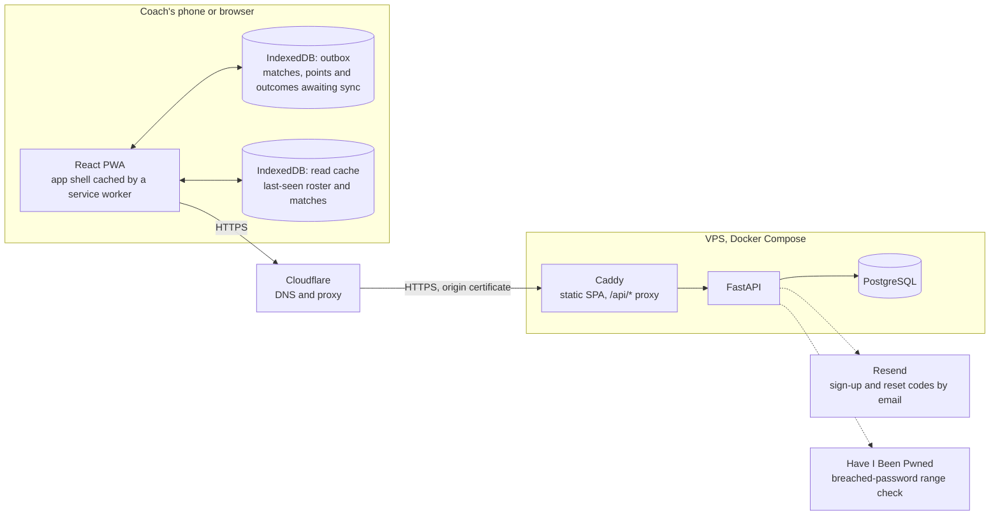

# MatchPoint

MatchPoint is a tennis statistics app for coaches. During a match, a coach records each point on
their phone as it happens: serve, rally outcome, rally length. Capture works with no signal and
syncs when a connection returns. Between matches, the same data becomes an analytics dashboard of
serve percentages, rally-length win rates and trends across matches and opponents, so training
decisions rest on evidence rather than recollection.

## Try it

For the duration of the course the prototype was hosted at <https://matchpoint.thomaskabalin.com>;
to run it yourself, see [Getting started](#getting-started). It is a progressive web app, so it
installs from the browser rather than an app store:

- iOS (Safari): Share → Add to Home Screen.
- Android (Chrome): accept the install prompt, or menu → Install app.

Installed, it opens full-screen and keeps working without a connection.

## Team

- **Thomas Kabalin**: API, data model, offline sync, security, infrastructure, and CI/CD.
- **Danny Gebhard**: frontend — accounts, player roster, match management, statistics dashboard, and
  styling.
- **Luke Bryant**: frontend — match setup, live capture, and scoring engine.

## Architecture



Solid arrows are the request path, from the app through the proxy to the database; dotted arrows are
the API's calls to third-party services; cylinders are data stores.

Points captured during a match are appended to the outbox on the device, never sent directly. The
sync layer drains the outbox to the API whenever a connection exists, so the capture screen behaves
the same with or without signal. The outbox and the read cache are separate databases, so clearing
cached reads can never touch a point that has not synced. Caddy serves the app and proxies `/api/*`
from one hostname, so there is no cross-origin traffic to configure. The server stores what it
receives and answers the analytics queries; the scoring itself runs on the device. See
[docs/offline-sync.md](docs/offline-sync.md) for the sync protocol and
[docs/security.md](docs/security.md) for the policy behind the two external calls.

## Stack

| Layer    | Key technologies                                                                            |
| -------- | ------------------------------------------------------------------------------------------- |
| Frontend | React · Vite · TypeScript · Tailwind · shadcn/ui · TanStack Router/Query · Dexie · Recharts |
| Backend  | FastAPI · Pydantic · SQLAlchemy · Alembic · Python                                          |
| Infra    | PostgreSQL · Caddy · Docker Compose · GitLab CI                                             |

See [docs/tech-stack.md](docs/tech-stack.md) for the full breakdown with versions, tooling, and test
frameworks.

UI components are generated with the shadcn CLI rather than hand-built — see
[`.claude/rules/web-components.md`](.claude/rules/web-components.md) for the instructions.

## Getting started

These instructions target Ubuntu/Debian Linux, including WSL2, and nothing else. macOS is not
supported: the scripts under `scripts/` use bash associative arrays and GNU `date`, neither of which
a BSD userland provides. On Windows, work inside your WSL2 distro and run every command below from
its bash shell — not from PowerShell or cmd, which cannot run the scripts at all and whose Node and
pnpm binaries do not understand WSL paths.

### Prerequisites

| Tool   | Version    | Notes                                                                                                  |
| ------ | ---------- | ------------------------------------------------------------------------------------------------------ |
| Node   | ≥ 22.13    | Required by pnpm 11. `.nvmrc` pins the major; CI uses 22 LTS.                                          |
| pnpm   | 11.18.0    | Pinned by `packageManager`; install via corepack, not `npm install -g`.                                |
| Python | 3.12       | Pinned in `apps/api/.python-version`.                                                                  |
| uv     | ≥ 0.11     | Enforced by `required-version` in `apps/api/pyproject.toml`. Manages the Python venv and dependencies. |
| Docker | any recent | Runs PostgreSQL locally via `docker-compose.yml`. Docker Compose v2 (`docker compose`) is required.    |

```sh
# nvm — see https://github.com/nvm-sh/nvm for the latest install script
curl -o- https://raw.githubusercontent.com/nvm-sh/nvm/v0.40.6/install.sh | bash

# nvm only wires itself into your shell profile — load it into this shell too, or open a new terminal
\. "$HOME/.nvm/nvm.sh"

# Node + pnpm — `nvm use` reads .nvmrc
nvm install && nvm use
corepack enable && corepack prepare pnpm@11.18.0 --activate

# uv — see https://docs.astral.sh/uv/ for other install methods
curl -LsSf https://astral.sh/uv/install.sh | sh
```

If you don't already have Docker, install
[Docker Engine](https://docs.docker.com/engine/install/ubuntu/) directly. On WSL2 you can instead
install [Docker Desktop for Windows](https://docs.docker.com/desktop/setup/install/windows-install/)
and turn on WSL integration for the specific distro you develop in (Settings → Resources → WSL
Integration → toggle your distro on, then Apply & Restart).

Either way, `docker compose version` should report Compose v2 once done.

### Install

```sh
git clone https://github.com/tkabalin/matchpoint.git   # public mirror
# or, with UCT GitLab access: git clone git@gitlab.cs.uct.ac.za:tldr/matchpoint.git
cd matchpoint

pnpm install                          # web app + root tooling, from the repo root
cd apps/api && uv sync --group dev    # API, from apps/api
```

PostgreSQL runs via Docker Compose rather than a native install. The previous step leaves you in
`apps/api`, so `cd` back to the repo root first — `docker compose` reads `docker-compose.yml` from
there:

```sh
docker compose up -d --wait                       # starts Postgres, from the repo root
cd apps/api && uv run alembic upgrade head        # applies migrations
```

The default `MATCHPOINT_DATABASE_URL` already matches the Compose credentials, so no `.env` file is
required for local dev — copy `apps/api/.env.example` to `apps/api/.env` only to override it.

`apps/api` is a uv project, deliberately **not** a pnpm workspace member — never run `pnpm install`
inside it.

pnpm 11 enforces a `minimumReleaseAge` supply-chain policy: packages published within the last day
are rejected. If `pnpm install` fails with `ERR_PNPM_MINIMUM_RELEASE_AGE_VIOLATION` after you add a
dependency, the fix is normally to wait rather than to relax the policy.

### Run

```sh
docker compose up -d                            # Postgres, from the repo root (if not already running)
pnpm dev                                        # web app  → http://localhost:5173
cd apps/api && uv run fastapi dev src/matchpoint_api/main.py   # API → http://localhost:8000
```

Check the API is up with `curl http://localhost:8000/health`; interactive docs are at
`http://localhost:8000/docs`.

Alternatively, `scripts/dev.sh` validates prerequisite versions and runs all three steps above in
one go.

### The typed API client

The web app calls the API through `packages/api-client`, generated from the API's own OpenAPI spec —
so a route's request and response types are the ones the frontend compiles against, and a mismatch
is a type error rather than a runtime surprise.

Both the spec (`apps/api/openapi.json`) and the generated client are committed. After changing
anything a route exposes, regenerate them and commit the result alongside the change:

```sh
scripts/gen-api-client.sh
```

A stale spec fails `uv run pytest` in `apps/api`, and a stale generated client fails CI's
`web-api-client` job, which regenerates the client and diffs it against what was committed. Neither
is covered by `scripts/check.sh`, so run the script whenever a route changes.

### Check your work

Two scripts, run from anywhere in the repo:

- `scripts/format.sh` — formats web + API code in place. **Required before every commit.**
- `scripts/check.sh` — runs the full suite (web: format check, lint, typecheck, test; API: ruff
  format check, ruff check, pyright, pytest). **Optional but recommended before pushing** — not
  required, since CI runs the identical checks on every push/MR anyway, but running it locally first
  catches failures earlier. Like CI, it only ever reports — it never rewrites your files, so run
  `format.sh` to fix what it flags. The checks run concurrently, and every one runs to completion,
  so a single run reports all the failures rather than stopping at the first.

Underneath, both scripts run plain package-manager commands, so you can run a single step yourself
(e.g. just `pnpm run lint`) instead of the whole suite:

```sh
# From the repo root
pnpm run format && pnpm run lint && pnpm run typecheck && pnpm run test

# From apps/api
uv run ruff format . && uv run ruff check . && uv run pyright && uv run pytest
```

CI runs the same checks in verify mode rather than write mode — `pnpm run format:check` and
`uv run ruff format --check .` — so it fails the pipeline instead of reformatting. Formatting
locally first is what keeps it green.

Coverage is opt-in on both sides, so it is not part of `scripts/check.sh` or the plain test
commands. For a report, run `uv run pytest --cov` from `apps/api`, or
`pnpm --filter @matchpoint/web run test --coverage` from the repo root; CI collects both.

#### End-to-end tests

The Playwright suite in `apps/web/e2e/` drives the real app in a browser. `scripts/check.sh` leaves
it out because it is the slow tier; CI runs it on every push.

```sh
pnpm --filter @matchpoint/web exec playwright install chromium webkit --with-deps   # first run only
pnpm --filter @matchpoint/web run test:e2e
```

Playwright starts the Vite dev server and the API itself, the latter through `scripts/e2e-api.sh` on
a database of its own, so the Compose Postgres must be up and a dev API from the Run step must be
stopped first. What each tier covers, and why, is in [docs/testing.md](docs/testing.md).

## Repository structure

```
apps/
  web/                      # React Single Page Application (Vite)
    public/
    e2e/                    # Playwright end-to-end specs
    index.html              # Vite entry point
    components.json         # shadcn CLI config (style, aliases, base colour)
    playwright.config.ts
    scripts/                # gen-icons.mjs (PWA icons), generate-fake-data.ts
      fake-data/            # generated demo season, committed rather than ignored
        import/             # the same season in the CSV format import_sample_data.py reads
    src/
      routes/
      features/             # feature slices, one directory each
        auth/
        capture/            # network-free zone (enforced by ESLint)
        home/
        matches/
        outbox/             # Dexie queue of captured points, one row per write
        players/
        profile/
        pwa/
        settings/
        stats/
        sync/               # drains the outbox to the API
      components/
        ui/                 # shadcn components
      lib/                  # shared helpers
  api/                      # FastAPI service (uv project)
    media/                  # uploaded photos on a dev box (gitignored)
    migrations/
    scripts/                # one-off operator scripts, e.g. import_sample_data.py
    src/matchpoint_api/     # app factory, config
      models/
      schemas/
      routers/
    tests/
packages/                   # shared libraries
  api-client/               # generated, not hand-edited
infra/                      # deployment config for matchpoint-prod
scripts/                    # dev setup/check/format helpers
.claude/
  rules/                    # path-scoped conventions for Claude Code
  skills/                   # task procedures for Claude Code
docs/                       # finished, production-ready documentation only
  scratch/                  # gitignored — in-progress/planning notes, not tracked
deliverables/               # graded course submissions (e.g. assignment write-ups), not docs/ or app code
CODEOWNERS                  # who reviews what
skills-lock.json            # pins the vendored skills under .claude/skills/
```

The web app is sliced by **feature**, not by file type, so architectural rules can be scoped to a
directory.

## Contributing

See [CONTRIBUTING.md](CONTRIBUTING.md) for branching, commit and code-style conventions.
