# Data Model

The database schema, and the conventions every table in it follows. The Alembic revisions in
`apps/api/migrations/versions/` are the authority on the schema; this page is the map, so a revision
that changes the shape should update the diagram with it.

## Entity relationship diagram

The diagram below is Mermaid source. GitLab renders it as a diagram in the file view and in merge
requests; in an editor that doesn't, paste the block into an online Mermaid viewer.

```mermaid
erDiagram
    coaches ||--o{ players : owns
    coaches ||--o{ coach_sessions : "signs in as"
    coaches ||--o| password_resets : "resets password via"
    players ||--o{ player_sessions : "signs in as"
    players ||--o| player_transfer_codes : "moves coach via"
    players ||--o{ player_notes : "is written up in"
    players ||--o{ matches : plays
    matches ||--o{ match_sets : "is scored in"
    matches ||--o{ points : "is captured as"
    matches ||--o{ score_checkpoints : "is declared at"
    coaches ||--o{ deleted_matches : "deleted"

    coaches {
        uuid id PK
        varchar(254) email UK "the sign-in identity, stored lowercased"
        varchar(100) display_name "full name, or whatever they go by"
        text password_hash "argon2id hash"
        text photo_key "nullable: the profile photo's filename, served from /api/media"
        varchar(6) default_surface "nullable: match-setup default, same members as matches.surface"
        varchar(24) default_scoring_system "nullable: match-setup default, same members as matches.scoring_system"
        timestamptz created_at
        timestamptz updated_at
    }

    coach_sessions {
        uuid id PK
        uuid coach_id FK "the signed-in coach"
        varchar(64) token_hash UK "sha-256 of the cookie token, never the token"
        timestamptz expires_at "when an abandoned login dies"
        timestamptz created_at
        timestamptz updated_at
    }

    email_verifications {
        uuid id PK
        varchar(254) email UK "the address proving itself, stored lowercased"
        varchar(64) otp_hash "nullable: sha-256 of the emailed code"
        varchar(64) token_hash UK "nullable: sha-256 of the verification cookie token"
        int attempts "wrong guesses against the current code"
        timestamptz expires_at
        timestamptz created_at
        timestamptz updated_at
    }

    password_resets {
        uuid id PK
        uuid coach_id FK,UK "the account being reset; unique, so one live code each"
        varchar(64) otp_hash "nullable: sha-256 of the emailed code"
        varchar(64) token_hash UK "nullable: sha-256 of the reset cookie token"
        int attempts "wrong guesses against the current code"
        timestamptz expires_at
        timestamptz created_at
        timestamptz updated_at
    }

    players {
        uuid id PK
        varchar(100) first_name
        varchar(100) last_name
        varchar(20) username UK "the sign-in identifier, minted by the server from the name"
        text password_hash "nullable: argon2 of the coach-minted password; null cannot sign in"
        date date_of_birth "nullable"
        varchar(5) dominant_hand "nullable: right, left"
        varchar(6) gender "nullable: male, female, other"
        text notes "nullable: coach notes"
        text photo_key "nullable: the profile photo's filename, served from /api/media"
        uuid coach_id FK "the owning coach"
        timestamptz created_at
        timestamptz updated_at
    }

    player_sessions {
        uuid id PK
        uuid player_id FK "the signed-in player"
        varchar(64) token_hash UK "sha-256 of the cookie token, never the token"
        timestamptz expires_at "a deadline slid forward on use"
        timestamptz created_at
        timestamptz updated_at
    }

    player_notes {
        uuid id PK
        uuid player_id FK "the player the note is about, and the note's only owner"
        text body "what the coach noticed"
        date recorded_on "the session the note is about, not when it was written"
        varchar[] focus_areas "varchar(9) elements: technical, mental, physical, tactical; empty when filed under none"
        timestamptz created_at
        timestamptz updated_at
    }

    player_transfer_codes {
        uuid id PK
        uuid player_id FK,UK "the player on offer; unique, so one live code each"
        varchar(64) token_hash UK "sha-256 of the code, never the code"
        timestamptz created_at
        timestamptz updated_at
    }

    matches {
        uuid id PK
        uuid player_id FK "the coach's tracked player"
        varchar(100) opponent_name "nullable: free text, not a player"
        date played_on
        varchar(6) surface "nullable: hard, clay, grass, carpet"
        varchar(100) event "nullable: tournament or fixture"
        varchar(24) scoring_system "nullable: traditional, mens_grand_slam, no_ad_scoring, match_tiebreak_10_points, short_sets, pro_set, legacy"
        varchar(4) result "nullable: win, loss"
        uuid capture_claim_device_id "nullable: the device capturing this match"
        timestamptz capture_claim_expires_at "nullable: when that claim lapses"
        timestamptz created_at
        timestamptz updated_at
    }

    match_sets {
        uuid id PK
        uuid match_id FK "the match, and the one foreign key that cascades on delete"
        int set_number "the set's position in the match, from 1, unique per match"
        int games_won_tracked
        int games_won_opponent
        varchar(8) winner "nullable while the set is in flight: tracked, opponent"
        timestamptz created_at
        timestamptz updated_at
    }

    points {
        uuid id PK "client-assigned, like every offline-captured row"
        uuid match_id FK "the match this point belongs to"
        int sequence "the point's position in the match, from 0, unique per match"
        varchar(8) server "tracked, opponent"
        boolean won "the tracked player's side, always"
        varchar(5) serve1_outcome "nullable: in, fault, ace; null when the serve went unwatched"
        varchar(5) serve1_box "nullable: deuce, ad; null on an opponent serve, a fault, or a serve nobody watched"
        varchar(4) serve1_fault_mode "nullable: net, long, wide; set only on a faulted serve of the tracked player's"
        varchar(5) serve2_outcome "nullable: in, fault, ace; set only after a first-serve fault"
        varchar(5) serve2_box "nullable: deuce, ad; null where no second serve was played, and otherwise for serve1_box's reasons"
        varchar(4) serve2_fault_mode "nullable: net, long, wide; set only on a faulted second serve of the tracked player's"
        varchar(4) return_outcome "nullable: in, net, long, wide; set only on an opponent-serve point"
        varchar(12) end_reason "nullable: forced, mistake, ace, double_fault, unusual; null when the ending went unwatched"
        varchar(15) unusual_reason "nullable: net_touch, ball_hit_player, reached_over, double_hit, hindrance, point_penalty, other"
        text note "nullable: a coach's annotation, legal on any point"
        varchar(8) wing "nullable: forehand, backhand; set together with shot_type"
        varchar(8) shot_type "nullable: drive, volley, dropshot, lob"
        boolean ball_in "nullable"
        varchar(5) ball_half "nullable: deuce, ad; set together with ball_depth"
        varchar(5) ball_depth "nullable: short, deep"
        varchar(4) ball_out_mode "nullable: net, long, wide"
        varchar(2) rally_length_bucket "nullable: b1=1-2, b2=3-5, b3=6-10, b4=11+ shots, per the capture screen; null means genuinely unknown"
        int set_number "1-based"
        int game_number "1-based within its set"
        boolean in_tiebreak
        boolean is_break_point
        boolean is_game_point
        boolean is_game_end
        boolean is_set_point
        boolean is_set_end
        boolean is_match_point
        timestamptz created_at
        timestamptz updated_at
    }

    score_checkpoints {
        uuid id PK "client-assigned, like every offline-captured row"
        uuid match_id FK "the match whose board was declared"
        int sequence "its place among the match's points and checkpoints, unique per match"
        varchar(8) serves_next "tracked, opponent: who serves the next game"
        boolean order_changed "the serving order deviated from the rotation, and this re-anchors it"
        jsonb after "the declared scoreboard: one entry per set with games, breaker and winner"
        timestamptz created_at
        timestamptz updated_at
    }

    deleted_matches {
        uuid id PK "a deleted match's own id; no foreign key, the row it named is gone"
        uuid coach_id FK "the coach who deleted it"
        timestamptz deleted_at "when the delete happened, and the only timestamp here"
    }
```

A match carries metadata only. Point-level data is captured against a match rather than stored on
it. `result` is the exception: capture is optional, so a match can carry an outcome with no point
data to compute it from. A match is in progress while `result` is null, and complete once one is
recorded. Completion freezes `result` and `scoring_system`, and only those two: the result is the
completion signal itself, and the scoring system is the rulebook the client scored the points under,
so changing it relabels a match already played. The descriptive fields stay editable afterwards, so
correcting a typo'd opponent name does not cost the match and its points.

The `capture_claim_` columns enforce single-writer capture: one device at a time, with a lapsing
expiry the device must renew. The device id is not a foreign key to `coach_sessions`, because a
session can rotate under a live capture (password change, fresh login) without ending it.

`scoring_system` names the system the match was played under. What each name implies belongs to the
client that scores the match; the database stores the label and never interprets it.

`match_sets` is a server-derived cache, not client-sent data. A set's score is the board the newest
score checkpoint declared, plus a group-by over the points after it, recomputed at the end of each
ingest or delete so that analytics read a handful of set rows instead of replaying points. `winner`
is null while a set is in flight.

`points` is one row per point, in the order the client assigned via `sequence`. A row is never
rewritten: the client appends, or deletes the newest one when the coach undoes it. There is no
timestamp (client clocks are unreliable) and no foreign key to a set or game: `match_sets` is
derived from `set_number`/`game_number` via group-by. The `is_*`/`in_tiebreak` booleans are stamped
by the client's scoring engine and never recomputed server-side, since that logic already lives in
the client for offline use.

`score_checkpoints` is the coach's own word on the score. Capture's score editor records what the
board says now, whether to correct a mis-tap or to catch up on games nobody watched, and the client
stores that as one checkpoint rather than fabricating the points behind it. A checkpoint shares the
match's `sequence` space with its points, so the two interleave into one record. `after` is the
declared scoreboard as a document, validated structurally on the way in (sides, non-negative counts,
sets numbered from 1) and never against the rules: the client is the rulebook, and stamps each set's
`winner` the way it stamps `is_set_end`.

Deleting a match deletes its points and checkpoints too: the realistic delete is a coach backing out
of a mis-set-up match. `deleted_matches` stops a delete being undone by a create still queued
offline, whether the match went on its own or with the player it was recorded against: a queued
create or point-flush naming a deleted id gets `410 Gone` rather than a 404, so the client can
discard rather than surface an error. The record is kept for thirty days and holds only the id and
the deleting coach.

`email_verifications` stands alone: it holds addresses proving themselves at sign-up, before any
coach row exists. `otp_hash` and `token_hash` are exactly-one-of under a CHECK, one row per address.
`password_resets` uses the same pattern, keyed on the coach rather than an address.

`player_transfer_codes` is how a player changes coach. The current coach mints a code, hands it over
out of band, and the redeeming coach becomes the owner: `players.coach_id` moves, and the matches
follow through the player. One row per player; minting again replaces the old code. A live code
refuses deletion of the player or closure of the minting coach's account, since the code is a claim
another coach may still act on.

`player_notes` is the coach's running record of what they noticed, one row per note, dated to the
session rather than to the moment it was typed so a write-up done later files under the day it is
about. `players.notes` is a different field and stays: it is the profile's standing description,
overwritten on each edit, where these accumulate. A note reaches its coach through its player, as a
match does, so a transfer carries the notes to the new coach and neither field is readable by the
player.

## Conventions

**UUID primary keys, not serials.** Capture happens offline, so a row needs an identity before any
server sees it. `match_sets` is the exception: a server-derived row has no offline identity.

**Timestamps default to `clock_timestamp()`, not `now()`.** `now()` is the transaction timestamp, so
a batch of rows synced together would share a creation time. Every table carries `created_at` and
`updated_at`, both `timestamptz`. `deleted_matches` is the exception, carrying only `deleted_at`.

**Enums are VARCHAR with a named CHECK constraint**, not native Postgres enums. Postgres cannot
remove a value from a native enum, so a migration adding one could not be rolled back.
`player_notes.focus_areas` is the one multi-valued enum: a VARCHAR array whose CHECK constrains the
elements rather than the column, so it keeps the same rollback property.

**No JSON columns, with one exception.** A field the server reads or filters on is a column.
`score_checkpoints.after` is a declared scoreboard: a bounded document the server validates on the
way in and only ever reads whole, never queries inside, so splitting it into a child table would be
plumbing for nothing.

**Foreign keys are indexed explicitly and declare no `ondelete`.** A delete that would orphan rows
is refused. Routes that intend to cascade (deleting a match, a player, or closing an account) delete
each child table themselves, so the refusal is a backstop: a new child table left out of that list
stops the delete loudly. `match_sets.match_id` is the one FK that cascades, since derived rows are
not coach-entered data.

**Most columns are nullable.** Match and player setup happens courtside and has to be fast.
`coaches` is the exception: every column is NOT NULL, since all are collected at sign-up.

**No soft deletes.** A deleted row is gone. The route owns the cascade and names each child table. A
match under active capture is refused unless the holding device itself is deleting it. A
`deleted_matches` row is the one thing a delete writes rather than removes.

**Photos are files, not bytes.** `photo_key` names a re-encoded image outside the database. An image
column would bloat every query and leave nothing for a client to cache by URL.

**No pagination.** At club scale, collections are tens of rows. A page size would cost every caller
the work of reassembling a list.
