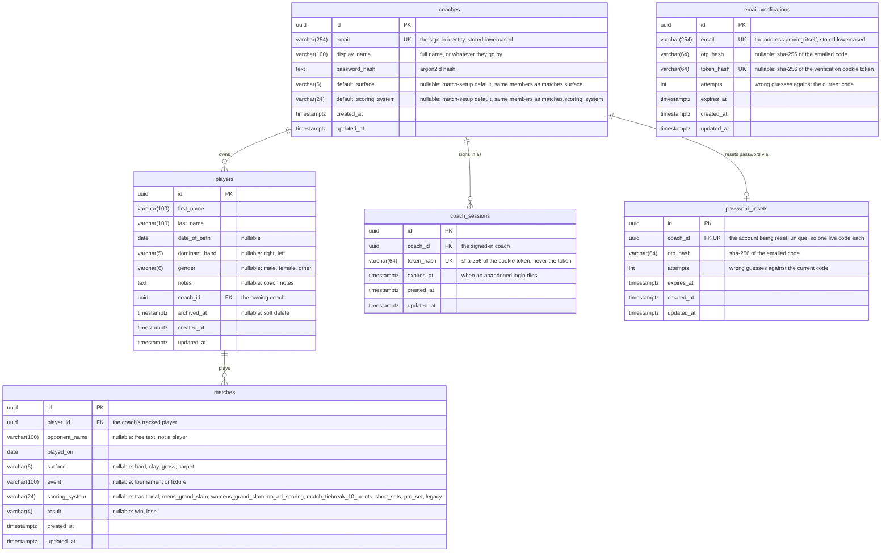

# Data Model

The database schema, and the conventions every table in it follows. The Alembic revisions in
`apps/api/migrations/versions/` are the authority on the schema; this page is the map, so a revision
that changes the shape should update the diagram with it.

## Entity relationship diagram

The diagram below is Mermaid source. GitLab renders it as a diagram in the file view and in merge
requests; in an editor that doesn't, paste the block into an online Mermaid viewer.

A match carries metadata only. Point-level data — serves, rally outcomes, rally length — is captured
against a match rather than stored on it, and is modelled separately. `result` is the exception, a
win or loss held on the row rather than derived from points: capture is optional, so a match can
carry an outcome with no point data to compute it from.

`scoring_system` names the system the match was played under and nothing more. What each name
implies (deuce or sudden death at 40-40, how long a set runs, what settles the decider) belongs to
the client that scores the match, so the database stores the label and never interprets it.

`email_verifications` stands alone by design: it holds addresses proving themselves at sign-up,
before any coach row exists to reference. A row is either an unanswered code or a proven
verification — `otp_hash` and `token_hash` are exactly-one-of, held by a named CHECK constraint —
and one row per address means a re-requested code replaces the old one rather than accumulating.

## Conventions

**UUID primary keys, not serials.** Capture happens offline, so a row is created on the client and
reaches the server later; it needs an identity it can be given before any server sees it. That also
keeps rows unenumerable, which matters for a table like `coaches` where an id is the only thing
guarding a record.

**Timestamps default to `clock_timestamp()`, not `now()`.** In Postgres `now()` is the _transaction_
timestamp, so a batch of rows synced in one transaction would share a creation time — voiding any
ordering that uses `created_at` to break a tie. Every table carries `created_at` and `updated_at`,
both `timestamptz`. That is a column default; a timestamp a route computes for itself, a session
expiry or an `archived_at`, comes from Python's clock.

**Enums are VARCHAR with a named CHECK constraint**, not native Postgres enums (`str_enum` in
`models/types.py`). Postgres cannot remove a value from a native enum, so a migration adding one
could not honestly be rolled back. The column is sized to the longest permitted value, which is why
the widths above look arbitrary.

**Foreign keys are indexed explicitly and declare no `ondelete`.** Postgres does not index a foreign
key automatically. Leaving off `ondelete` means a delete that would orphan rows is refused outright
rather than cascading through a roster and the match history hanging off it.

**Optional unless the value is genuinely required.** Player and match setup happens courtside and
has to be fast, so beyond the fields that identify a row there is little a coach must fill in.
`coaches` is the exception — every column is NOT NULL, because all of them are collected at sign-up
and a row missing any of them is not an account.

**Deletion is soft where history depends on it.** A player with matches recorded against them cannot
be removed without taking that history along, so `archived_at` takes them off the active roster
while leaving them readable by id. Archiving stops at the roster: the matches recorded against a
player stay listed and resolvable, since that history is what the soft delete exists to keep. A
match is deleted outright, because a match entered by mistake is cleared away before anything is
recorded against it. A table that comes to reference matches declares no `ondelete` like every other
foreign key here, so Postgres refuses to delete a match once point data hangs off it.

**Lists come back whole, with no pagination.** At club scale these collections are tens of rows: one
coach's roster, and the matches recorded against it. A page size would buy nothing and cost every
caller the work of reassembling a list, so it is worth revisiting only if a list outgrows that.
