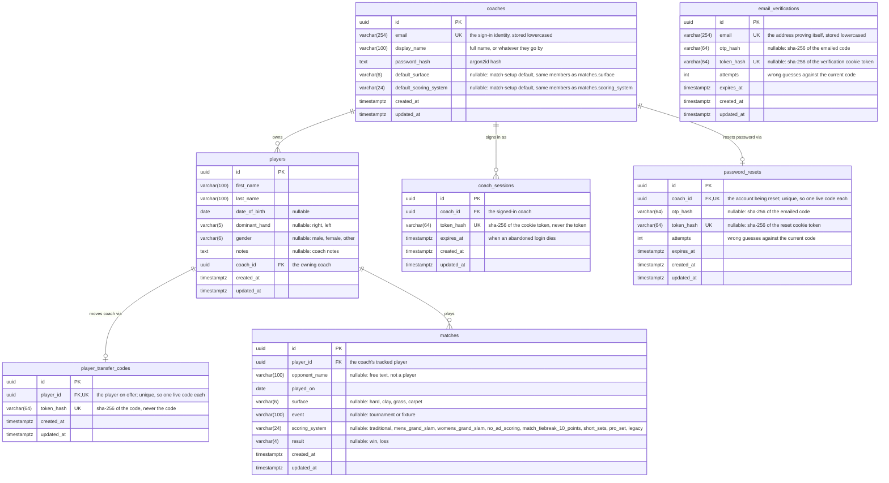

# Data Model

The database schema, and the conventions every table in it follows. The Alembic revisions in
`apps/api/migrations/versions/` are the authority on the schema; this page is the map, so a revision
that changes the shape should update the diagram with it.

## Entity relationship diagram

The diagram below is Mermaid source. GitLab renders it as a diagram in the file view and in merge
requests; in an editor that doesn't, paste the block into an online Mermaid viewer.

A match carries metadata only. Point-level data — serves, rally outcomes, rally length — is captured
against a match rather than stored on it, and is modelled separately. `result` is the exception, a
win or loss held on the row rather than derived from points: capture is optional, so a match can
carry an outcome with no point data to compute it from.

`scoring_system` names the system the match was played under and nothing more. What each name
implies (deuce or sudden death at 40-40, how long a set runs, what settles the decider) belongs to
the client that scores the match, so the database stores the label and never interprets it.

`email_verifications` stands alone by design: it holds addresses proving themselves at sign-up,
before any coach row exists to reference. A row is either an unanswered code or a proven
verification — `otp_hash` and `token_hash` are exactly-one-of, held by a named CHECK constraint —
and one row per address means a re-requested code replaces the old one rather than accumulating.

`password_resets` holds the same two states for an account that already exists, so it is keyed on
the coach rather than an address: an unanswered code, then the proof that it was answered,
exactly-one-of under a CHECK of its own, one row per coach.

`player_transfer_codes` is how a player changes coach. Players switch coaches as they grow up, and
the roster is coach-scoped, so without a transfer the history a new coach most needs is the history
they cannot see. The current coach mints a code, hands it over out of band, and the coach who
redeems it becomes the owner: `players.coach_id` moves, and the matches follow, since a match
reaches its owner through its player rather than a coach column of its own. One row per player, and
redeeming deletes it. There is no `expires_at`, so a player can carry the code to a coach the
current one never meets; the minting coach can delete the row to cancel it. A live code also refuses
both routes that would destroy the player, deleting them and closing the minting coach's account,
since it is a claim another coach may still act on.

## Conventions

**UUID primary keys, not serials.** Capture happens offline, so a row is created on the client and
reaches the server later; it needs an identity it can be given before any server sees it. That also
keeps rows unenumerable, which matters for a table like `coaches` where an id is the only thing
guarding a record.

**Timestamps default to `clock_timestamp()`, not `now()`.** In Postgres `now()` is the _transaction_
timestamp, so a batch of rows synced in one transaction would share a creation time — voiding any
ordering that uses `created_at` to break a tie. Every table carries `created_at` and `updated_at`,
both `timestamptz`. That is a column default; a timestamp a route computes for itself, a session
expiry, comes from Python's clock.

**Enums are VARCHAR with a named CHECK constraint**, not native Postgres enums (`str_enum` in
`models/types.py`). Postgres cannot remove a value from a native enum, so a migration adding one
could not honestly be rolled back. The column is sized to the longest permitted value, which is why
the widths above look arbitrary.

**Foreign keys are indexed explicitly and declare no `ondelete`.** Postgres does not index a foreign
key automatically. Leaving off `ondelete` means a delete that would orphan rows is refused outright
rather than cascading through a roster and the match history hanging off it. The routes that do mean
to take the children with them (deleting a player, and closing an account) delete each child table
in turn themselves, so the refusal stays in place as a backstop: a table added under `players` or
`coaches` and left out of one of those lists stops the delete loudly instead of being quietly
missed.

**Optional unless the value is genuinely required.** Player and match setup happens courtside and
has to be fast, so beyond the fields that identify a row there is little a coach must fill in.
`coaches` is the exception — every column is NOT NULL, because all of them are collected at sign-up
and a row missing any of them is not an account.

**Deletion is deletion, and the route owns the cascade.** No table carries a deleted flag: a row a
coach asks to be rid of goes, and what hung off it goes with it. Deleting a player takes the matches
recorded against them, in one transaction; deleting a match takes nothing further, a match entered
by mistake being cleared away before anything is recorded against it. The route names each child
table itself rather than leaning on the database, which is what the no-`ondelete` foreign keys are
for: a table added under players or matches and left out of that list refuses the delete outright
instead of being quietly missed. Nothing is recoverable afterwards, so the confirmation belongs to
the client, where the coach can be shown what they are about to lose.

**Closing a coach account is erasure, and takes their data with it.** A closed-but-kept coach would
just be their email, name and password hash sitting on a row nothing can reach, which is not what
someone asking to be removed has asked for. So the closure deletes the coach and everything below
them: their players, the matches recorded against those players, their sessions and any live reset
code, in one transaction. Nothing keys on the address, so it is free for a fresh sign-up
immediately, and no row survives to link the new account to the old one.

**A closure is refused while any player is still on the roster.** Players move between coaches as
they grow up, so a name still on the roster may be one another coach is about to take over, and
erasing it with the account would take a history that was never only this coach's. Each player has
to be cleared first, transferred away or deleted, and the refusal is a status the closure form
branches on. A coach who does mean to leave nothing behind says so on the closure request instead of
deleting one by one, and the clearing and the delete then share a transaction, so there is no
half-closed account to be stranded in. A live transfer code on any player refuses closure regardless
of that waiver: the code is a claim another coach may still act on, not this coach's data to discard
by asking to leave nothing behind. Deleting that player on its own is refused for the same reason,
so the refusal cannot be walked past a player at a time. The code must be cancelled or redeemed
first.

**Lists come back whole, with no pagination.** At club scale these collections are tens of rows: one
coach's roster, and the matches recorded against it. A page size would buy nothing and cost every
caller the work of reassembling a list, so it is worth revisiting only if a list outgrows that.
