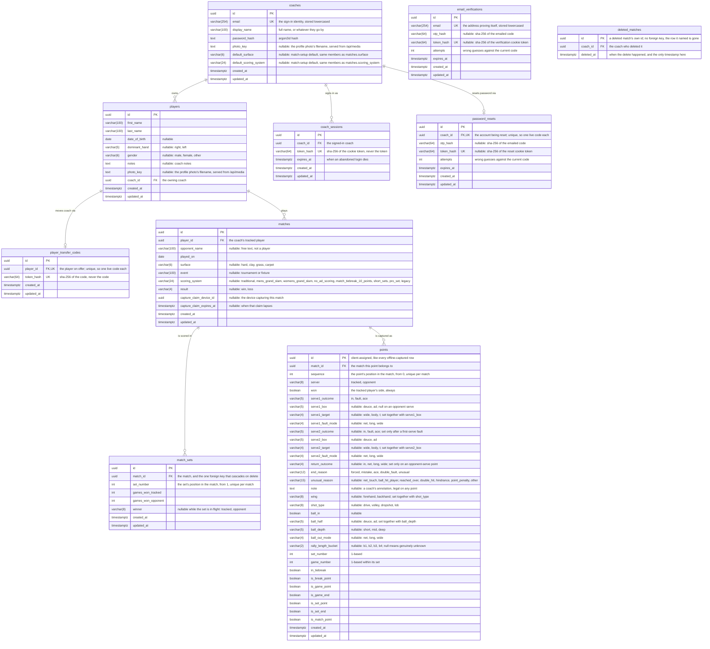

# Data Model

The database schema, and the conventions every table in it follows. The Alembic revisions in
`apps/api/migrations/versions/` are the authority on the schema; this page is the map, so a revision
that changes the shape should update the diagram with it.

## Entity relationship diagram

The diagram below is Mermaid source. GitLab renders it as a diagram in the file view and in merge
requests; in an editor that doesn't, paste the block into an online Mermaid viewer.

A match carries metadata only. Point-level data — serves, rally outcomes, rally length — is captured
against a match rather than stored on it, and is modelled separately. `result` is the exception, a
win or loss held on the row rather than derived from points: capture is optional, so a match can
carry an outcome with no point data to compute it from.

A match's lifecycle is read off the row rather than stored: it is in progress while `result` is
null, and complete once a result is recorded. The two `capture_claim_` columns are the exception,
the one piece of state capture genuinely adds, and they are one fact under a CHECK: which device is
capturing the match, and when that claim lapses if the device stops renewing it. Capture is
single-writer per match, so a second device is refused while a live claim stands. The device id is
not a foreign key to `coach_sessions`: a session can rotate under a live capture, a password change
or a fresh login on the same device, without ending it, and keying the claim to the session would
strand it rather than let it keep renewing.

`scoring_system` names the system the match was played under and nothing more. What each name
implies (deuce or sudden death at 40-40, how long a set runs, what settles the decider) belongs to
the client that scores the match, so the database stores the label and never interprets it.

`match_sets` is a cache the server derives rather than anything a client sends. Every captured point
carries the set and game number the capture client stamped on it, so a set's score is a group-by
over the points the server holds, recomputed for the whole match at the end of each ingest: a late,
partial or duplicated batch lands on the same answer, and analytics read a handful of set rows
instead of replaying points. `winner` is null while a set is in flight, since the client marks the
point that closes a set and until one arrives the tally is only a score so far. A tiebreak needs no
column of its own, being another game, so a 7-6 set stores 7-6.

`points` is the capture record: one row per point, in client-assigned order, and append-only. An
undo before sync is an outbox delete on the device, never a write here, so the table carries no
correction or tombstone column, and no timestamp: the client's `sequence` is the order the server
trusts. `set_number`, `game_number` and the `is_*`/`in_tiebreak` flags are stamped by the client's
own scoring engine and never recomputed here, since that logic already has to run offline.

Deleting a match deletes its points too, in the same transaction as deleting a player or closing an
account: the realistic delete is a coach backing out of a mis-set-up match, and its points would
otherwise skew that player's statistics for good. `deleted_matches` stops that delete being undone
by a create still queued offline: `POST /matches` upserts on a client-chosen id, so a queued create
or point-flush naming a deleted id gets `410 Gone` rather than the ordinary 404, which stays
reserved for an id that was never this coach's, such as a player just transferred away — the client
discards on 410 and surfaces a 404 to the coach. The record is kept for thirty days, long enough for
an offline outbox to plausibly still be flushing, and holds only the id and the coach who deleted
it: no match data survives the delete for anything more to be read off. The coach is kept only so
account closure can find and remove the row; the 410 check above reads the id alone and stays
unscoped by coach, the way it already had to before the column existed.

`default_surface` and `default_scoring_system` on `coaches` are match-setup defaults, not a separate
preferences table: a coach has at most one value for each, so a join would buy nothing a column
doesn't already give. The server never applies them itself: a match created offline has to keep
`MatchCreate`'s distinction between a field left absent and one set to null, and substituting a
default server-side would erase that distinction before it reaches storage. The client reads the
defaults once at setup and fills the field in, or doesn't.

`email_verifications` stands alone by design: it holds addresses proving themselves at sign-up,
before any coach row exists to reference. A row is either an unanswered code or a proven
verification — `otp_hash` and `token_hash` are exactly-one-of, held by a named CHECK constraint —
and one row per address means a re-requested code replaces the old one rather than accumulating.

`password_resets` holds the same two states for an account that already exists, so it is keyed on
the coach rather than an address: an unanswered code, then the proof that it was answered,
exactly-one-of under a CHECK of its own, one row per coach.

`player_transfer_codes` is how a player changes coach. Players switch coaches as they grow up, and
the roster is coach-scoped, so without a transfer the history a new coach most needs is the history
they cannot see. The current coach mints a code, hands it over out of band, and the coach who
redeems it becomes the owner: `players.coach_id` moves, and the matches follow, since a match
reaches its owner through its player rather than a coach column of its own. One row per player, and
redeeming deletes it. There is no `expires_at`, so a player can carry the code to a coach the
current one never meets; the minting coach can delete the row to cancel it. Minting again while a
code is already live replaces the row outright rather than adding a second one: the old code's hash
is gone, so it can never be redeemed, which is what the unique-per-player constraint is for. A live
code also refuses both routes that would destroy the player, deleting them and closing the minting
coach's account, since it is a claim another coach may still act on.

## Conventions

**UUID primary keys, not serials.** Capture happens offline, so a row is created on the client and
reaches the server later; it needs an identity it can be given before any server sees it. That also
keeps rows unenumerable, which matters for a table like `coaches` where an id is the only thing
guarding a record. `match_sets` is the exception, and its id is the server's own: a derived row
never exists on a device, so there is no offline identity to preserve.

**Timestamps default to `clock_timestamp()`, not `now()`.** In Postgres `now()` is the _transaction_
timestamp, so a batch of rows synced in one transaction would share a creation time — voiding any
ordering that uses `created_at` to break a tie. Every table carries `created_at` and `updated_at`,
both `timestamptz`, bar `deleted_matches`, which carries one `deleted_at`: its row records that a
delete happened, so a creation stamp beside it would be the same fact written twice. That is a
column default; a timestamp a route computes for itself, a session expiry, comes from Python's
clock.

**Enums are VARCHAR with a named CHECK constraint**, not native Postgres enums (`str_enum` in
`models/types.py`). Postgres cannot remove a value from a native enum, so a migration adding one
could not honestly be rolled back. The column is sized to the longest permitted value, which is why
the widths above look arbitrary.

**Foreign keys are indexed explicitly and declare no `ondelete`.** Postgres does not index a foreign
key automatically, so each key carries an index of its own unless it already leads one belonging to
a unique constraint, as `player_transfer_codes.player_id`, `match_sets.match_id` and
`points.match_id` do. Leaving off `ondelete` means a delete that would orphan rows is refused
outright rather than cascading through a roster and the match history hanging off it. The routes
that do mean to take the children with them (deleting a match, deleting a player, and closing an
account) delete each child table in turn themselves, so the refusal stays in place as a backstop: a
table added under `matches`, `players` or `coaches` and left out of one of those lists stops the
delete loudly instead of being quietly missed. `match_sets.match_id` is the one foreign key that
cascades: the refusal exists to protect data a coach entered, and a derived row is not that, so it
follows its match out rather than standing in the way of deleting one.

**Optional unless the value is genuinely required.** Player and match setup happens courtside and
has to be fast, so beyond the fields that identify a row there is little a coach must fill in.
`coaches` is the exception — every column is NOT NULL, because all of them are collected at sign-up
and a row missing any of them is not an account.

**Deletion is deletion, and the route owns the cascade.** No table carries a deleted flag: a row a
coach asks to be rid of goes, and what hung off it goes with it. Deleting a player takes the matches
recorded against them, in one transaction; deleting a match takes the points captured against it the
same way, and the set rows derived from those points through the cascade above rather than a line in
the route. Otherwise the route names each child table itself rather than leaning on the database,
which is what the no-`ondelete` foreign keys are for: a table added under players or matches and
left out of that list refuses the delete outright instead of being quietly missed. Nothing is
recoverable afterwards, so the confirmation belongs to the client, where the coach can be shown what
they are about to lose. A `deleted_matches` row is the one thing a delete writes rather than
removes, and it holds an id and the deleting coach, nothing else, for the reason given above it.

**A match being captured is not deleted out from under the device capturing it.** Deleting it
regardless would leave that device queuing points against a match that no longer exists. The delete
is refused while a live claim stands, except from the holding device itself, which can still back
out of its own capture; any other device must release the claim first. Deleting the player or
closing the account skips this check and takes the match anyway, since a stale claim on the coach's
own device shouldn't hold up the coach's own data indefinitely.

**Closing a coach account is erasure, and takes their data with it.** A closed-but-kept coach would
just be their email, name and password hash sitting on a row nothing can reach, which is not what
someone asking to be removed has asked for. So the closure deletes the coach and everything below
them: their players, the matches recorded against those players, their sessions, any live reset
code, and any `deleted_matches` row their own deletes left behind, in one transaction. Nothing keys
on the address, so it is free for a fresh sign-up immediately, and no row survives to link the new
account to the old one.

**A closure is refused while any player is still on the roster.** Players move between coaches as
they grow up, so a name still on the roster may be one another coach is about to take over, and
erasing it with the account would take a history that was never only this coach's. Each player has
to be cleared first, transferred away or deleted, and the refusal is a status the closure form
branches on. A coach who does mean to leave nothing behind says so on the closure request instead of
deleting one by one, and the clearing and the delete then share a transaction, so there is no
half-closed account to be stranded in. A live transfer code on any player refuses closure regardless
of that waiver: the code is a claim another coach may still act on, not this coach's data to discard
by asking to leave nothing behind. Deleting that player on its own is refused for the same reason,
so the refusal cannot be walked past a player at a time. The code must be cancelled or redeemed
first.

**A photo is a file, and the row holds only its name.** `photo_key` names a re-encoded image in a
directory outside the database, not the bytes: an image column would grow every row that a query
touches whether or not it wanted pixels, and would leave nothing for a client to cache by URL. The
cost is that the file and the row are no longer one transaction, so the ordering is fixed everywhere
they change together: commit the row, then unlink the file it replaced, never the reverse. An
unreferenced file costs a few kilobytes and is unreachable, since its name appears in no row and
cannot be guessed; a row naming a file that is gone costs a broken image on every render and looks
exactly like a bug. Nothing sweeps the orphans, which only a crash in the moment between a write and
a commit can produce. Closing an account is the one place the keys have to be collected before the
deletes rather than after, because afterwards there is no row left to read them from.

**Lists come back whole, with no pagination.** At club scale these collections are tens of rows: one
coach's roster, and the matches recorded against it. A page size would buy nothing and cost every
caller the work of reassembling a list, so it is worth revisiting only if a list outgrows that.
